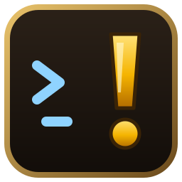
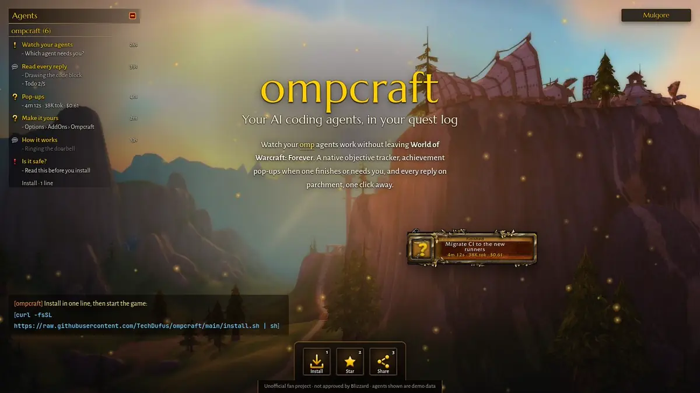
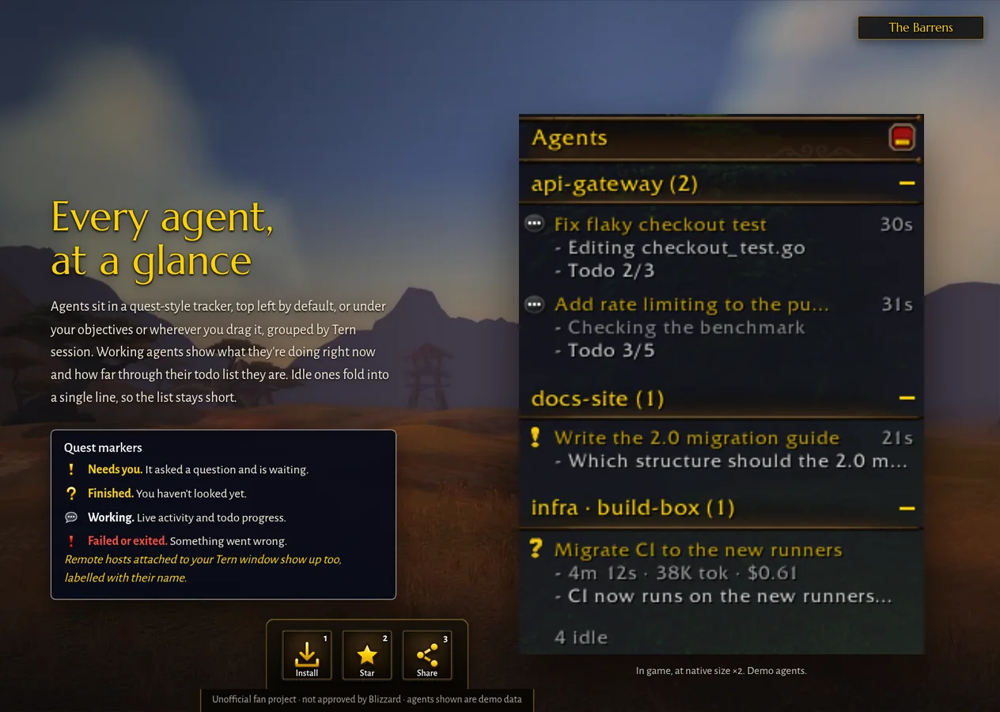
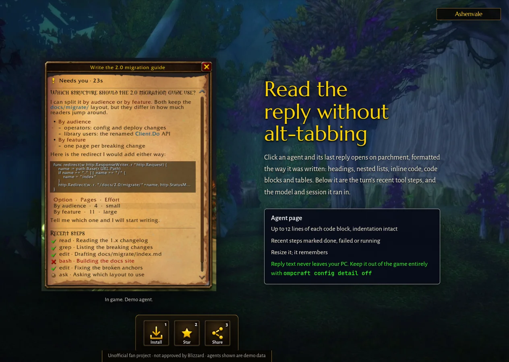
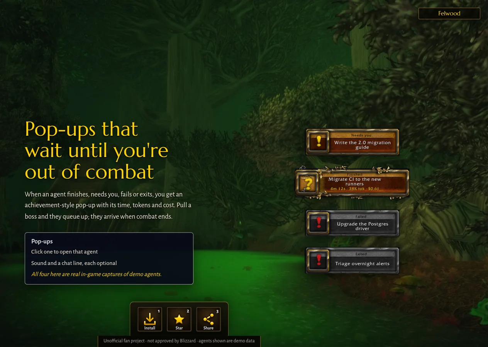
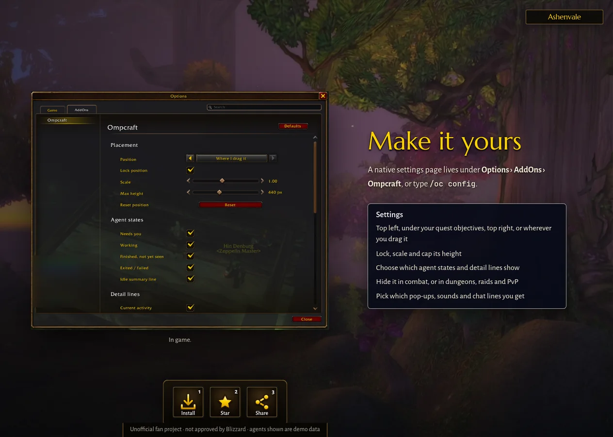
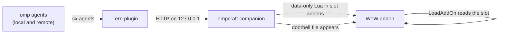

<div align="center">



# ompcraft

**Your AI coding agents, in your quest log.**

[](https://github.com/TechDufus/ompcraft/actions/workflows/ci.yml)
[](https://github.com/TechDufus/ompcraft/releases)
[](LICENSE)

[Website](https://ompcraft.techdufus.com/) · [Install](#install) · [Features](#features) · [How it works](#how-it-works) · [Is it safe?](#is-it-safe) · [FAQ](#faq)

<a href="https://ompcraft.techdufus.com/"><picture><source media="(prefers-reduced-motion: reduce)" srcset="docs/media/hero-still.webp"></picture></a>

</div>

ompcraft puts your [omp](https://github.com/can1357/oh-my-pi) coding agents inside **World of Warcraft: Forever**.

- **Watch:** agents that need you get a quest **!**, finished ones a **?**, and working ones show what they are doing right now.
- **Read:** click an agent to read its last reply.
- **Never miss a turn:** finished and needs-you moments arrive as achievement-style pop-ups.

All of it waits until you're out of combat.

- **Native.** It looks and behaves like Blizzard's own objective tracker, so it belongs on your screen.
- **Live.** "Needs you" and "finished" reach the game within about a second, and activity lines refresh as you play. No `/reload`.
- **Local.** Everything stays on your PC. There's no account, no cloud, and no screen capture.
- **One line to install,** and it keeps itself up to date.

> [!WARNING]
> ompcraft is an unofficial fan project and is **not approved by Blizzard**. The addon uses only public addon APIs, and the companion only writes files on your own disk, but the link depends on undocumented client behaviour that Blizzard can change. It never reads game memory, sends keystrokes, or plays the game for you. Read [Is it safe?](#is-it-safe) before you install.

## Install

```sh
curl -fsSL https://raw.githubusercontent.com/TechDufus/ompcraft/main/install.sh | sh
```

Then start World of Warcraft. Your agents appear in a quest-style tracker in the top-left corner; move it under your quest objectives or anywhere else from the settings.

**You need:**

- WoW: Forever. On Linux it runs through Battle.net under Wine or Proton; tested with Proton through umu, and Lutris or Steam setups should work the same way.
- [Stencil Tern](https://stencil.so) with omp agents running in it, and a Tern window open.

**What the script does:**

- installs one program, `ompcraft`, to `~/.local/bin`, checked against the release's SHA-256 checksums (later automatic updates also verify the release's ed25519 signature);
- finds your game and installs the addon (asking you to quit WoW first if it has to);
- links the Tern plugin;
- starts the companion as a user service that comes back after reboot.

Run it again whenever you like; it's safe to re-run.

<details>
<summary>From source, or before a release exists</summary>

```sh
git clone https://github.com/TechDufus/ompcraft && cd ompcraft
./install.sh            # builds this checkout with Go 1.27+, then runs `ompcraft setup`
```

Or with Go only: `go install github.com/TechDufus/ompcraft/companion/cmd/ompcraft@latest && ompcraft setup`.

</details>

<details>
<summary>macOS</summary>

macOS support is planned. The companion builds and its launchd service is written, but it is untested, so expect rough edges.

</details>

## Quick start

1. Run the install line, then start WoW.
2. Agents show up in the top-left tracker. **Click** an agent to read its reply.
3. Type `/oc config` to open the settings, or find them under **Options › AddOns › Ompcraft**.
4. If something looks off, `ompcraft doctor` checks every piece and tells you what to fix.

## Features

<table>
<tr>
<td width="50%"></td>
<td width="50%"></td>
</tr>
<tr>
<td><b>Every agent at a glance.</b> Grouped by Tern session, with live activity and todo progress. Yellow <b>!</b> needs you, yellow <b>?</b> finished and unseen, a speech bubble is working, red <b>!</b> failed or exited. Idle agents fold into one line.</td>
<td><b>Read the reply without alt-tabbing.</b> Click an agent: its last reply on parchment, with headings, lists, code and tables, plus recent tool steps and the model and session.</td>
</tr>
<tr>
<td></td>
<td></td>
</tr>
<tr>
<td><b>Pop-ups that wait for combat to end.</b> Finished, needs-you, failed and exited, with the turn's time, tokens and cost. Click one to open that agent.</td>
<td><b>Make it yours.</b> <b>Options › AddOns › Ompcraft</b> or <code>/oc config</code>: placement, lock, scale and height; which states and detail lines show; hide in combat or instances; which pop-ups, sounds and chat lines you get.</td>
</tr>
</table>

<sub>Game UI in these images is real in-game capture with invented demo agents (<code>ompcraft demo</code>), framed by the project website. Zone backgrounds are official World of Warcraft: Forever screenshots © Blizzard Entertainment.</sub>

## How it works

WoW addons can't open sockets or files. So ompcraft passes data the only ways an addon can read it: through load-on-demand addon files it loads, and through sound files whose presence it can check.



| Piece | Runs where | Does |
|---|---|---|
| `tern-plugin/` | inside your Tern window | reads agent state, replies and tool steps through Tern's plugin API, including agents on remote hosts |
| `companion/` | a user service on your PC | turns that into a small Lua snapshot and writes it into pre-installed "slot" addons, then rings a doorbell file |
| `addon/Ompcraft/` | the game | notices the doorbell, loads the next slot with `C_AddOns.LoadAddOn`, and draws the tracker |

Nothing travels from the game to your PC in this release. The companion never sends input to the game. Snapshot files are plain data (no code), and they're wiped when the game or the companion exits.

The full design is in [`docs/PROTOCOL.md`](docs/PROTOCOL.md) and the research behind it is in [`docs/RESEARCH.md`](docs/RESEARCH.md).

## Is it safe?

**What it does:**

- It's a normal Lua addon using public APIs, plus a separate program that writes files into your `Interface/AddOns` folder. WeakAuras Companion and the TSM and Wago apps have done the same for years.
- The addon is free, and its code is fully visible. Blizzard's add-on policy requires both.

**What it never does:**

- read or modify game memory or the game client;
- inject anything into the client;
- capture your screen;
- send keystrokes, clicks or controller input;
- automate any gameplay.

Agent output is text you read. It never becomes casts, macros or chat.

**What it respects:**

- combat lockdown;
- Blizzard's secret-value restrictions;
- the add-on policy: no ads, no donation asks in game, and no chat spam.

**Is it against the ToS?** No Blizzard text approves or forbids a tool like this. It relies on undocumented client behaviour that Blizzard can change at any time, and Blizzard has said it is locking down addon communication workarounds. The EULA gives no safe harbour, so **use it at your own risk**. The policy analysis and the hard rules this project follows are in [`docs/RESEARCH.md` §5](docs/RESEARCH.md#5-blizzard-tos-and-add-on-policy).

**Privacy.**

- Agent replies and tool steps are written to plain files under the game's `AddOns` folder while you play. They're cleared when the game exits and when the companion stops.
- `ompcraft config detail off` keeps reply text out of those files entirely.
- Nothing leaves your PC.

## Status

| | |
|---|---|
| Linux (Proton via umu tested; Wine, Lutris, Steam expected) | ✅ works on the author's setup |
| macOS | 🚧 planned |
| WoW: Forever 1.60.x (TOC 16001) | ✅ |
| omp in Stencil Tern, local and remote hosts | ✅ |
| Replying, interrupting, approvals from the game | 🚧 next ([plan](docs/PLAN.md)) |

ompcraft is young. Expect changes between releases, and when a WoW patch lands, expect a quick fix.

## Configuration

**In game:**

| Command | Does |
|---|---|
| `/oc` | show or hide the tracker |
| `/oc config` | open the settings page |
| `/oc status` | link details |
| `/oc lock`, `/oc unlock`, `/oc reset` | placement |
| `/oc help` | every command |

**On your PC:**

| Command | Does |
|---|---|
| `ompcraft doctor` | check everything and say what to fix |
| `ompcraft status` | what the companion is doing |
| `ompcraft config detail off` | keep reply text out of the game's files |
| `ompcraft config autoupdate off` | stop automatic updates |
| `ompcraft uninstall` | remove everything ompcraft added (`--purge` also deletes settings) |

## Updates

Release builds update themselves:

- They check GitHub about every six hours.
- They verify the release's **ed25519 signature** before trusting anything in it.
- They wait until you quit WoW to install.
- If a new version fails to start three times, they roll back to the previous one.

`ompcraft update` updates now. Builds from source never replace themselves.

## FAQ

<details>
<summary>The tracker is empty.</summary>

Run `ompcraft doctor`. The usual causes are that no Tern window is open, or that the game was started before ompcraft was installed. New addon folders only appear after a full game restart, not a `/reload`.

</details>

<details>
<summary>Why are there so many "Ompcraft link" addons in my AddOns list?</summary>

They're the link helpers: the files the companion writes updates into. They live in a collapsible "Ompcraft link helpers" section. Collapse it once and it stays collapsed. Don't disable them.

</details>

<details>
<summary>Does it work with remote agents?</summary>

Yes. Any host your Tern window is attached to shows up, labelled with its host name.

</details>

<details>
<summary>Can I reply to agents from the game?</summary>

Not yet. It's the next milestone. It needs a game → PC channel, which raises its own policy questions, so it will ship switched off.

</details>

## Development

```sh
go test ./... && lua5.1 addon/tests/run.lua      # Go companion and the addon against a strict WoW API stub
./install.sh                                      # build this checkout and run setup, as users do
ompcraft demo                                     # invented agents, for screenshots (stop the service first)
python3 -m http.server -d site 8000               # preview the website; ?still freezes it for README captures
```

The addon is checked against Blizzard's generated API docs for the `forever` client branch. [`docs/PLAN.md`](docs/PLAN.md) has the roadmap.

## Credits

Ideas and small pieces come from projects that got there first: [t3code-wow](https://github.com/ryanrhughes/t3code-wow), [ForeverPlusPlus](https://github.com/xIGBClutchIx/ForeverPlusPlus), [wow-ai](https://github.com/chelinho139/wow-ai) and [wow-forever-codex](https://github.com/0xinuarashi/wow-forever-codex). See [`NOTICE.md`](NOTICE.md).

## License

MIT. See [`LICENSE`](LICENSE).

World of Warcraft and Blizzard Entertainment are trademarks or registered trademarks of Blizzard Entertainment, Inc. ompcraft is not affiliated with or endorsed by Blizzard Entertainment.
