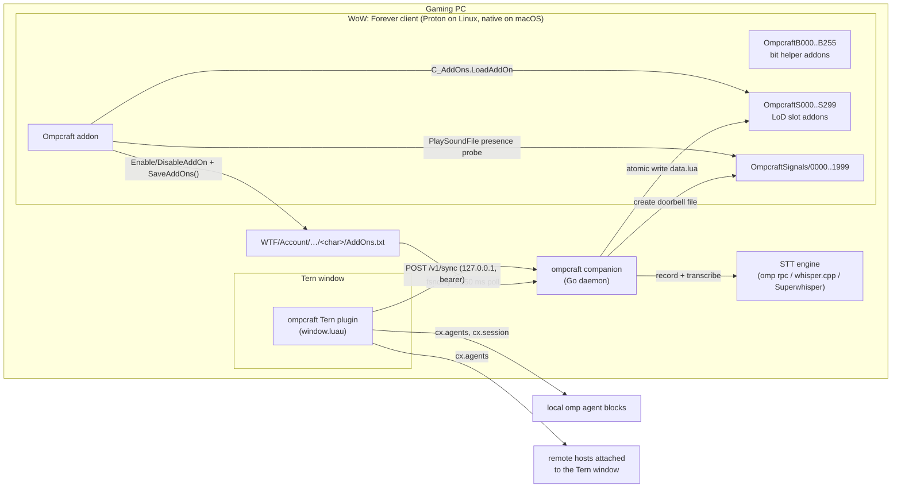
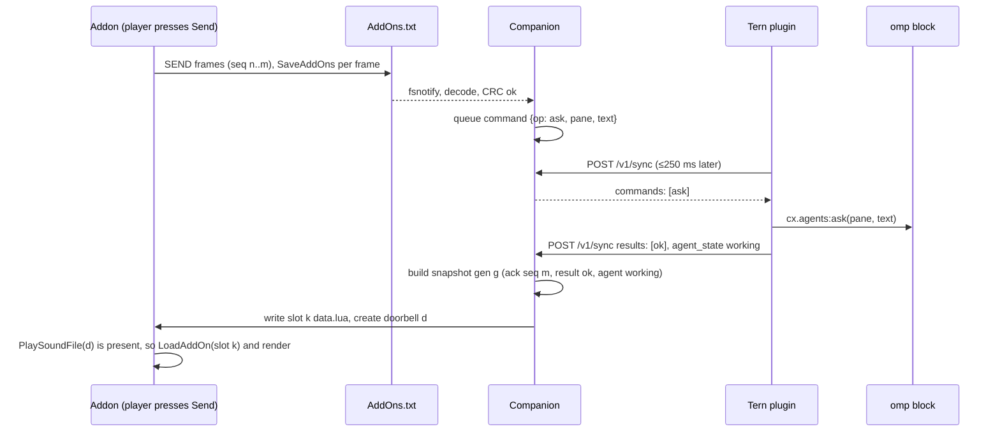

# ompcraft build plan

This plan builds on `docs/RESEARCH.md` (cited as R§n). Milestone M0.5, the read-only slice, is built and verified live (§7). Later milestones are still plans.

## 1. Decisions in one screen

| Topic | Decision | Why |
|---|---|---|
| Game → PC | **Addon-list bits.** N one-bit helper addons, toggled with `C_AddOns.EnableAddOn` / `DisableAddOn(name, character)`, then `C_AddOns.SaveAddOns()`. The companion watches `AddOns.txt`. | No screen capture or permissions. Identical on Linux, macOS and Windows. Proven in-game on 70862 [3P-LIVE] (R§1.2). |
| PC → game | **Load-on-demand slot addons** carrying data-only Lua, plus **pre-created sound-file doorbells** probed with `PlaySoundFile`. | The only proven in-game read path (R§1.3). |
| Pixel strip | **Not built.** It can be revived as an opt-in fallback transport only if Blizzard breaks `SaveAddOns`. | Ban and break risk, intrusive on screen (R§5.5). |
| Font channel | **Not built.** | Reported not working on live Forever (ForeverPlusPlus, build 70862, [3P-LIVE]); contradicts wow-forever-codex on beta build 69913 (R§1.3). |
| Agent backend | **The Tern window plugin is the only control plane.** It uses `cx.agents` and `cx.session`. | Spans remote hosts and drives the user's visible sessions; approvals verified (R§2.3–2.4). |
| Plugin ↔ companion | **Loopback HTTP.** The companion listens on `127.0.0.1`. The plugin short-polls `POST /v1/sync` every 250 ms with a bearer token. | The plugin cannot listen. Fetch only returns promptly for immediate responses (R§2.5, R§2.7). |
| omp direct | **Only an optional dictation engine** (`omp --mode rpc`, `dictation_start` / `dictation_stop`). | Sessions must stay visible in Tern (R§3). |
| Input | **The game never receives generated input.** Every in-game action is a player keypress, click or pad press in the addon's own UI. | R§5.4, R1. |

## 2. Architecture



A send, end to end:



## 3. Repository layout

```
ompcraft/
  addon/
    Ompcraft/                    the only hand-written addon the player sees
      Ompcraft.toc               ## Interface: 16001
      Core/                      Init, Uplink, Downlink, Doorbell, Store, Slash, SelfTest
      UI/                        MainFrame, AgentList, Transcript, Composer, Toasts, Tracker, Minimap, (M3) Gamepad
      Bindings.xml
    tests/                       busted specs + wowstub.lua (stub generated from Blizzard API docs)
  companion/
    cmd/ompcraft/                CLI: setup, doctor, status, uninstall, config, install, run
    internal/
      gamedir/                   find WoW (_forever_), Wine/Proton prefixes, characters, AddOns.txt paths
      install/                   generate helper bits/slots/signals (game must be closed)
      uplink/                    AddOns.txt parser + frame codec + reassembly/NAK
      downlink/                  snapshot builder, data-only Lua serializer, slot/doorbell writer, budget
      ternlink/                  HTTP server for the plugin, token, leader election, command queue
      agents/                    pane↔handle map, transcript cache, approval keys
      dictation/                 engines: omprpc, whispercpp, superwhisper (M4)
      screenshots/               Screenshot() file pairing (M5)
  go.mod, assets.go              repo-root module; the binary embeds addon/Ompcraft and tern-plugin
  tern-plugin/
    plugin.toml                  id = "ompcraft", window = "window.luau"
    window.luau                  sync loop, ops, approval surface adapter
    lib/                         fnv1a.luau, surface.luau, json helpers
    tests/                       luau tests with a fake cx
  protocol/
    vectors/                     golden vectors shared by Go, Lua and Luau tests
  docs/
    RESEARCH.md  PLAN.md  PROTOCOL.md (spec, from commit 3)  THREATS.md (M2)
  LICENSE  NOTICE.md  README.md  justfile  .editorconfig  stylua.toml  selene.toml
```

The companion generates helper addons (`OmpcraftB*`, `OmpcraftS*`, `OmpcraftSignals`) at install time. They are not committed.

## 4. Languages and toolchain

| Part | Language | Why | Tooling (all verified present on this machine) |
|---|---|---|---|
| Addon | Lua 5.1 (the WoW dialect) | Required by the game | `lua51` 5.1.5 and `lua51-busted` 2.3.0 (`extra`), `stylua` 2.6.0, `selene` 0.32.0 |
| Tern plugin | Luau | Required by Tern | `luau` 0.743 (`extra`). Type-check against `tern plugin types tern-plugin/` (`tern.d.luau`). |
| Companion | Go | Static binaries for linux, darwin and windows. Std-lib HTTP, crypto and atomic rename; fsnotify; ForeverPlusPlus shows the same stack works. | `go` 1.27.3 |

Alternatives rejected:

- TypeScript/Bun: it matches omp, but adds a large runtime to a resident daemon.
- Rust: no capability gain for this I/O glue.
- Python: packaging on macOS and Windows.

## 5. Wire protocol v1 (fresh design)

There are three hops. Every frame carries a version, and every message is idempotent by id.

### 5.1 Uplink: addon → companion over `AddOns.txt`

**Bits.**

- `OmpcraftB000…OmpcraftB{N-1}`. N is 256 by default; 512 if M0 shows `SaveAddOns` stays under 2 ms.
- Bit i lives in byte `i // 8`, at bit position `i % 8`, LSB first.
- The companion reads only `OmpcraftB*` lines from the current character's `AddOns.txt`.

**Frame layout.** A frame is `F = N/8` bytes:

| Byte | Field |
|---|---|
| 0 | `0xC1`: magic and version. An all-zero frame means idle. |
| 1 | `epoch`: random per UI load. A change means `/reload` or a relog. |
| 2 | `seq`: 1..255, wraps |
| 3 | `ackGen`: low 8 bits of the last applied downlink generation |
| 4 | `flags`: bit7 FIRST, bit6 LAST, bits0-5 payload length (≤ F−7) |
| 5..F−3 | payload |
| F−2..F−1 | CRC-16/CCITT-FALSE over bytes 0..F−3 |

**Pacing.**

- Each frame is held for `HOLD` = 100 ms. M0 tunes this between 50 and 250 ms.
- The addon applies only the bits that changed, then calls `SaveAddOns()`. Frames are sent only while there is something to send. When idle, the bits rest at all-zero.

**Reliability.**

- The addon keeps the last 64 frames.
- The companion records gaps in `seq` and returns them as `nak` in the next snapshot. The addon retransmits those frames.
- `ackGen` piggybacks downlink acknowledgement on every frame. With no uplink traffic, a `HELLO` refresh carries it, at most every 5 s while the window is open.

**Records.** Frames concatenate into a byte stream of records: `type:u8, len:varint, body`. Strings are UTF-8 prefixed with a varint length. `h` is a 1-byte agent handle assigned by the companion.

| Type | Record | Body |
|---|---|---|
| 0x01 | HELLO | proto, addonVersion, epoch, slotCursor, signalCursor, caps bitmap |
| 0x02 | STATE | flags: windowOpen, attending, inCombat, restricted (sent on change) |
| 0x03 | VIEW | h, transcriptCursor |
| 0x04 | SEND | msgId:varint, h, then either `text` or `dictRef:varint`. Dictated text is never re-uploaded. |
| 0x05 | INTERRUPT | msgId, h |
| 0x06 | APPROVE | msgId, h, approvalKey:u32, decision (0 once, 1 session, 2 deny). M2. |
| 0x07 | DICTATE | msgId, op (start, stop, cancel). M4. |
| 0x08 | SHOT | msgId, takenAt. M5, opt-in. |

### 5.2 Downlink: companion → addon over slots and doorbells

**Slots.**

- `OmpcraftS000…S299`, each with `## LoadOnDemand: 1`, `## Group: Ompcraft`, `## Interface: 16001` and one `data.lua`.
- TOC and XML bytes are identical across slots, which defeats addon-manager fingerprint collisions (R§1.8).

**Doorbells.**

- `OmpcraftSignals/0000…1999` are pre-created while the game is closed.
- The companion deletes them all when it sees a new `epoch`. It creates the next one after each publish. Each file works once per client launch (R§1.3).
- M0 decides `.ogg` vs `.wav`, and whether sound must be enabled.
- Controls: `ctl_present` always exists and `ctl_absent` never does. The addon checks both at login (SelfTest).

**Snapshot.** `data.lua` holds one assignment of **literals only**: no function calls, no concatenation, no `loadstring` input. It is produced by `internal/downlink/luaser`.

```lua
OmpcraftInbox = {
  v = 1, epoch = 173, gen = 42, nextSlot = 8, nextSignal = 114,
  ack = { seq = 201 }, nak = { 197, 198 },
  results = { { id = 77, ok = true }, { id = 78, ok = false, err = "agent busy" } },
  agents = {
    { h = 1, host = "gaming-pc", title = "CRAFT: …", cwd = "~/dev/ompcraft",
      model = "Opus 5.5", state = "working", since = 1731190000, last = "…",
      approval = nil },          -- M2: { key = 0x1a2b3c4d, title = "Allow tool: bash", details = { "Command: …" } }
  },
  view = { h = 1, cursor = 31, msgs = { { role = "assistant", text = "…", tools = { { n = "bash", s = "done", t = "…" } } } } },
  toasts = { { id = 9, kind = "finished", h = 1, text = "Done: …" } },
  dict = nil,                    -- M4: { ref = 5, state = "done", text = "…" }
  link = { tern = "ok", companion = "0.1.0", slotsLeft = 292 },
}
```

**Publish policy.**

- One slot per publish. Updates coalesce for 300 ms.
- While `attending`: priority, then view, then periodic refresh every 15 s.
- While the window is closed: toasts and approvals only, plus an agent-list refresh at most every 120 s.
- The `slotsLeft` counter is shown in the UI. When slots run out, the UI asks the player to `/reload`. The addon never calls `ReloadUI` itself.
- If no doorbell file is free, the addon loads the offered slot on a timer: 1 s, backing off to 5 s (the ForeverPlusPlus pattern).

### 5.3 Plugin hop: Tern plugin ↔ companion (JSON over loopback HTTP)

**Request.** `POST http://127.0.0.1:<port>/v1/sync` with `Authorization: Bearer <token>`. The port and token come from `~/.config/ompcraft/link.json` (mode 0600), which the plugin reads with `tern.fs.read(path, 4096)`.

```json
{ "proto": 1, "window": "", "vm": "7f3a…", "seq": 1042,
  "events": [
    { "t": "agents", "hosts": [ … cx.hosts:list() … ], "agents": [ … cx.agents:list() … ] },
    { "t": "state", "pane": "4538784184008707", "old": "working", "new": "waiting_input" },
    { "t": "finished", "pane": "…", "result": "done" },
    { "t": "result", "id": 77, "ok": true, "data": { } }
  ] }
```

**Response**, always immediate:

```json
{ "proto": 1, "leader": true, "interval_ms": 250,
  "commands": [
    { "id": 77, "op": "ask", "pane": "…", "text": "…" },
    { "id": 78, "op": "transcript", "pane": "…", "last": 40 },
    { "id": 79, "op": "interrupt", "pane": "…" },
    { "id": 80, "op": "approval.read", "pane": "…" },
    { "id": 81, "op": "approval.answer", "pane": "…", "key": 439041101, "decision": "deny" }
  ] }
```

**Rules:**

- Pane ids travel as decimal strings. They exceed 2^52 on remote hosts, for example `4538784184008707` (R§2.3).
- **Leader.** The companion grants `leader` to one `(window, vm)` at a time. A leader that is silent for 3 s is replaced. Non-leaders get `interval_ms: 2000` and no commands.
- **`agents` events are sent only when the list changes**, plus a full list every 10 s. `agent_state` events only trigger a re-list, because they coalesce (R§2.5).
- **`approval.read`** (M2):
  1. Read `cx.session:surface(pane)`.
  2. Find the node whose `role` is `omp.editor.ask.approval`.
  3. Return its title and detail texts plus `key = fnv1a32(pane .. title .. details)`.
- **`approval.answer`** (M2):
  1. Re-read the surface and recompute the key.
  2. If the key differs, return `{stale: true}`.
  3. Otherwise send `{ev = "action", id = <button id where p.actions.click == decision>, act = decision}`.
  4. Confirm by reading back state and transcript.
  5. Never use cached node ids (R§2.4).

## 6. MVP scope (M1)

**In game:**

- Main window: an agent list grouped by state (needs-you, working, idle, exited) showing host, cwd basename, model and elapsed time.
- Transcript of the last 40 messages, with tool calls as one-line rows (name, status, title).
- Composer as a multi-line EditBox: Send, plus Interrupt.
- Toasts for finished, failed and waiting_input, **held during combat and restricted states** and flushed afterwards.
- A tracker block anchored beside the ObjectiveTracker, showing working and waiting agents with timers.
- Minimap or AddonCompartment button. `/ompcraft` (alias `/oc`) with `selftest`, `status` and `reset`.
- Link status light: game ↔ companion, companion ↔ Tern.

**Companion:**

- `install`: detect `_forever_` including Wine/Proton/Lutris/umu prefixes, refuse if `Wow.exe` is running, generate helpers, copy the addon.
- `run` (daemon, systemd user unit), `status`, `doctor`, `uninstall`.
- Multi-character: watch the `AddOns.txt` of the character whose epoch is live.

**Tern plugin:** sync loop, leader, and `list` / `transcript` / `ask` / `interrupt`. Events are forwarded.

**Explicitly not in MVP:** approvals, gamepad, dictation, screenshots, starting or stopping agents from the game, macOS/Windows packaging (the code stays portable), game-state export.

**Done when:**

1. With WoW running under Proton on this PC and a Tern window open, the player can list all 20+ agents, including remote-host agents.
2. They can open one and read its last 40 messages.
3. A sent prompt appears in that omp block.
4. Interrupt stops a working turn.
5. A finished turn raises a toast within 2 s, held in combat.
6. Each of the above is checked on the live client with the M1 checklist, not just in stubs.

## 7. Milestones

| M | Scope | Exit criteria |
|---|---|---|
| **M0 Feasibility gate** (before any product code) | **Probe addon** `OmpcraftProbe` and a companion `probe` subcommand. Measure: (1) `SaveAddOns` time for 256/512 bits and the max safe frame rate; (2) whether `AddOns.txt` is replaced atomically, by observing torn reads; (3) `LoadAddOn` re-reading a rewritten slot under Proton; (4) doorbell presence semantics (`.ogg` vs `.wav`, sound off, after `/reload`); (5) whether a new folder appears after `/reload`; (6) symlinked helper folders under Wine; (7) Tern `fetch` delayed callbacks and `tern serve` hosting window plugins. | A table in `docs/M0.md` with build number, date and numbers for each item. If (1)–(4) fail, stop and revisit transports. |
| **M0.5 Read-only slice** (current, `docs/PROTOCOL.md` v0) | Agent status in game without any game → PC channel. The plugin syncs to the companion. The companion writes slots and doorbells. The addon shows a panel and toasts. The companion learns which slot the client loaded, and when a UI session starts, from Linux inotify `IN_OPEN` events on the slot and addon files. Verified live on 2026-11-09 under GE-Proton (PROTOCOL §2). | Agent list and state changes visible in game: **met**. Inotify opens confirmed in the companion log: **met**. Doorbell mode on the real client: **met**. `/oc status` showed `mode: doorbell`, and each publish was followed by a slot load 67–174 ms later. |
| **M1 MVP** | §6 | §6 "Done when" |
| **M2 Approvals** | `approval.read/answer`. In-game approval card (title, details, Approve / Approve for session / Deny), "needs you" tracker state and toast. Kill switch. Docs on setting `tools.approvalMode` (the default is `yolo`, so nothing prompts, R§2.4). | Approve and deny both proven on the live client against a real `always-ask` agent. Stale-key path proven by answering after the prompt changed. |
| **M3 Gamepad** | Window-owned `EnableGamePadButton/Stick` while open; chord to open from the world by polling `C_GamePad.GetDeviceMappedState` from a frame that never enables pad input (R§1.6); a content-keyed focus model; A, B, LB/RB, triggers, Y-hold reserved for dictation. Optional `SetVibration` on toast once its type strings are found. | Full MVP and M2 flows by pad only. No taint errors with `taintLog 1`. Action bars unaffected. |
| **M4 Dictation** | Companion engines behind one interface: omp RPC dictation (if `stt.enabled`), whisper.cpp CLI, Superwhisper CLI (`autoPasteEnabled false` enforced). PTT from an addon keybind or pad Y-hold → DICTATE start/stop → text returns in `dict`. The player reviews it and presses Send, which sends `SEND{dictRef}`. | Under 2 s from release to text for a 5 s clip on this PC. Nothing ever typed into WoW (§8 test). |
| **M5 Screenshots** (opt-in, off by default) | `/oc shot` or a button → `Screenshot()` → SHOT → companion pairs the newest file in the Screenshots dir within ±3 s → attaches the path in the next SEND text. CVars are suggested but not forced: `screenshotFormat=png`. | Works with the toggle on. Inert with it off. A visible indicator shows while armed. |
| **M6 Packaging** | macOS (native client, launchd, `/Applications/World of Warcraft/_forever_`) and Windows (junctions, as ForeverPlusPlus does). Release builds, plus a CurseForge/Wago-free distribution of the source. | Fresh-machine install docs verified on each OS. |
| **M7 Optional context** (opt-in) | Non-secret character context (zone, level) appended to prompts on request. Never during restrictions, never combat data (R9). | Off by default. Unit-tested gating. |

## 8. Test strategy

**Golden vectors.** `protocol/vectors/*.json` holds frames, records, CRCs and snapshots. The same vectors run in Go (`go test`), Lua 5.1 (busted) and Luau (the plugin's FNV and surface parsing). Any change to the codec fails all three.

**Addon:**

- busted specs run against `addon/tests/wowstub.lua`.
- The stub is generated from Blizzard's API docs on the `forever` branch of Gethe/wow-ui-source. Unknown globals and widget methods **error**, which follows t3code-wow's approach (R§1.8).
- Specs cover:
  - frame encoding and the diff-only bit apply;
  - retransmit on NAK;
  - slot and doorbell selection and exhaustion;
  - toast hold and flush across combat;
  - restricted-state gating;
  - snapshot apply idempotence across `gen`.

**Companion:**

- `go test` against temp game directories: a fake `AddOns.txt` writer replays the game's writes, including torn writes.
- Data-only serialiser fuzz test: parse the output with a Lua 5.1 parser and assert that it contains only literals.
- Budget and coalescing rules.
- `ternlink` leader election.
- Approval key staleness.

**Tern plugin:**

- Luau tests with a fake `cx` recorded from real `list()` / `surface()` output, saved from the probe as fixtures.
- **Contract test (manual or CI-optional).** Link the plugin into a real Tern and start a throwaway `omp --approval-mode always-ask` agent in a temp dir, as R§2.4 did. Assert:
  - the surface roles `omp.editor.ask.approval` / `omp.approval.*` exist;
  - approve and deny take effect;
  - a stale key is refused.
- Run it on every Tern or omp version bump.

**Live client:** `/oc selftest` checks bits, a slot round trip, doorbell controls, Tern link and slots left. The M1 checklist in `docs/` is run by hand on the live client per release.

**Rule tests.** These guard R1–R12 and run in CI:

- A grep test asserts the companion never imports or execs input-synthesis tools: `xdotool`, `ydotool`, `wtype`, `dotool`, uinput, `CGEventPost`, `SendInput`.
- Superwhisper's auto-paste must be off before use.

## 9. Top risks

| # | Risk | Mitigation |
|---|---|---|
| 1 | Blizzard changes `SaveAddOns`, `LoadAddOn` re-reads, or `PlaySoundFile` presence, which kills a channel. They are actively closing "communication workarounds" (R§5.3). | Self-test at login. Each transport sits behind an interface. Degrade: timed slot loads instead of doorbells, read-only status instead of commands. Kill switch. Re-run M0 on every client build. |
| 2 | Account action under the EULA (R§5) | Follow hard rules R1–R12. No input. Data-only slots. Free, open source. Opt-in state and screenshots. Combat gating. Plain disclosure. Email WoWUI@blizzard.com before any public release. |
| 2a | **The `SaveAddOns` uplink is a deliberate signalling channel out of the client.** That is a different ToS question from read-only pixel capture, and no Blizzard text covers it (R§5.5). | Carry only player-authored commands and text, never game state. Name this channel explicitly in the WoWUI@blizzard.com email, and do not ship publicly before a reply or a deliberate go-ahead from the owner. If Blizzard objects, uplink is disabled and the addon becomes read-only (downlink only). |
| 3 | Approval-surface coupling breaks after an omp or Tern update (undocumented roles) | Version gate on `tern --version` / `omp --version` with a known-good list. The contract test above. On mismatch, fail closed: show "approve in Tern". Ask Stencil for a first-class `cx.agents:approve` API. |
| 4 | No Tern window open, or several windows | In-game status light. Leader election. Investigate `tern serve` headless hosting in M0. Document "keep a Tern window open". |
| 5 | `tern.fetch` delayed-callback behaviour (R§2.5) | Short-poll only. The file-spool transport is kept as a debug fallback. Report it to Stencil with the repro. |
| 6 | Slot budget runs out (once per UI session per slot) | Coalescing, priority classes, a closed-window diet, a visible counter, a player-initiated `/reload` prompt. The slot count is configurable at install. |
| 7 | Doorbells are one-shot per client launch, 2000 of them | Budget meter. Fall back to timed loads. The installer warns when fewer than 10 % are left. |
| 8 | Install needs the game closed and a full restart | The installer refuses while `Wow.exe` runs (`/proc` cmdline matching `_forever_` on Linux, `ps` on macOS). It prints exact next steps. |
| 9 | Wrong-target actions: stale pane, wrong agent, stale approval | Handles are re-validated against `list()` before each command. `msgId` idempotency. Approval key re-check. Results surface in game. |
| 10 | Privacy: transcripts sit in slot files, `AddOns.txt` holds prompt bits, and screenshots | Slots are wiped on companion exit and on `epoch` change. Nothing leaves the PC except what the player sends to their own agent. Screenshots are opt-in. |
| 11 | Taint and secret values on a Mainline-family client (R§6) | Addon-owned frames only. Never open Blizzard windows from code. No protected calls. `pcall` around handlers with an error ring buffer. `taintLog` in the M3 exit criteria. |
| 12 | Proton/NVIDIA client bugs (R§4.4) | Out of scope. Document known-good Proton builds. The design is OS-agnostic. |
| 13 | Uplink bandwidth is about 250 B/s at 256 bits (25-byte payload per 100 ms frame), or about 570 B/s at 512 bits, which makes long prompts slow | 512 bits if M0 allows. Dictation never re-uploads (`dictRef`). Show progress in the composer. Cap prompt size at 2 KB in MVP. |

## 10. Exact first commits

The repository is not yet a git repo. `git init -b main` comes first. Each commit below is self-contained and passes `just check`.

1. **`docs: add research findings and build plan`**
   - `docs/RESEARCH.md`, `docs/PLAN.md`.
2. **`chore: scaffold repository layout and tooling`**
   - `LICENSE` (MIT).
   - `NOTICE.md`: an attribution ledger with headings for t3code-wow (MIT, © 2026 Ryan Hughes), wow-ai (MIT, © 2026 chelinho139) and ForeverPlusPlus (MIT, © 2026 Cameron Weaver). Each entry lists the files and ideas taken. wow-forever-codex is noted as "unlicensed: ideas only, no code".
   - `README.md`: purpose plus the unofficial / no-safe-harbour disclosure (R12).
   - `.editorconfig`, `.gitignore`, `stylua.toml`, `selene.toml`.
   - `justfile`: `check` = `stylua --check`, `selene`, `busted`, `luau-analyze`, `go vet`, `go test`.
   - Empty `addon/`, `companion/go.mod` (`module github.com/techdufus/ompcraft/companion`), `tern-plugin/plugin.toml` (`schema = 1`, `id = "ompcraft"`, `window = "window.luau"`).
3. **`docs(protocol): specify wire protocol v1 and add golden vectors`**
   - `docs/PROTOCOL.md`, which turns §5 into a normative spec.
   - `protocol/vectors/uplink_frames.json`, `uplink_records.json`, `crc16.json`, `snapshot.json`.
4. **`feat(addon): add OmpcraftProbe for M0 in-game measurements`**
   - `addon/OmpcraftProbe/` (TOC 16001, slash `/ocprobe`) writes measurements to its SavedVariables.
5. **`feat(companion): add probe command for M0`**
   - `companion/cmd/ompcraft/probe.go`: generates probe helpers into a test game dir, watches `AddOns.txt`, times the slot and doorbell round trip, and prints the M0 table.
6. **`docs: record M0 results`**
   - `docs/M0.md`, filled from live runs. **This is the gate for everything below.**
7. **`feat(companion): uplink AddOns.txt decoder with vectors`**
   - `companion/internal/uplink/{addons_txt.go,frame.go,records.go}` plus tests.
8. **`feat(addon): uplink encoder with vectors`**
   - `addon/Ompcraft/Core/Uplink.lua`, `addon/tests/{wowstub.lua,uplink_spec.lua}`.
9. **`feat(companion): data-only Lua serializer, slot and doorbell writer`**
   - `companion/internal/downlink/` plus a fuzz test.
10. **`feat(tern-plugin): sync loop, leader election and agent list`**
    - `tern-plugin/window.luau`, `tern-plugin/lib/*.luau`, `companion/internal/ternlink/`.

Commits 1–3 land before any live-game work. From commit 4 on, every commit message names the WoW build it was checked against when it touches in-game behaviour.
